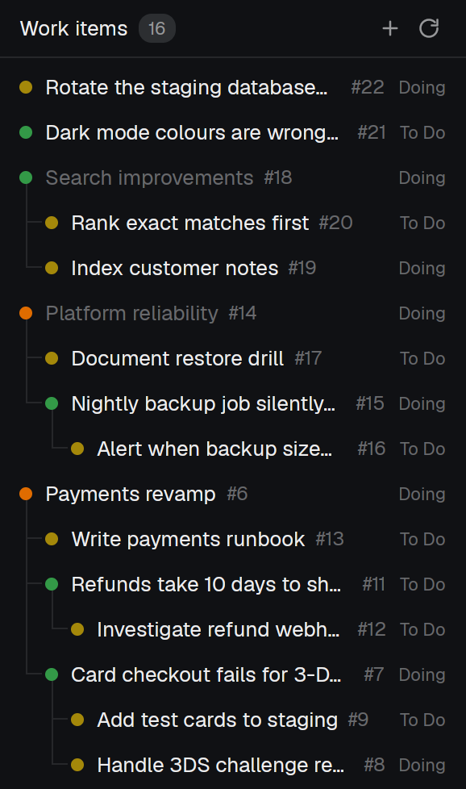

# ADO Work Items

A [Herdr](https://herdr.dev) panel listing your open Azure DevOps work items as a tree. Click a row to open it; **+** opens ADO to create one.



## Setup

```sh
az extension add --name azure-devops
az login
az devops configure --defaults organization=https://dev.azure.com/<org> project="<Project Name>"
cp -r mods/ado-work-items ~/.config/herdr-app/mods/
```

Needs the [Azure CLI](https://learn.microsoft.com/cli/azure/install-azure-cli). The mod runs `az` and nothing else.

See [RECIPE.md](RECIPE.md) to build it from scratch.
