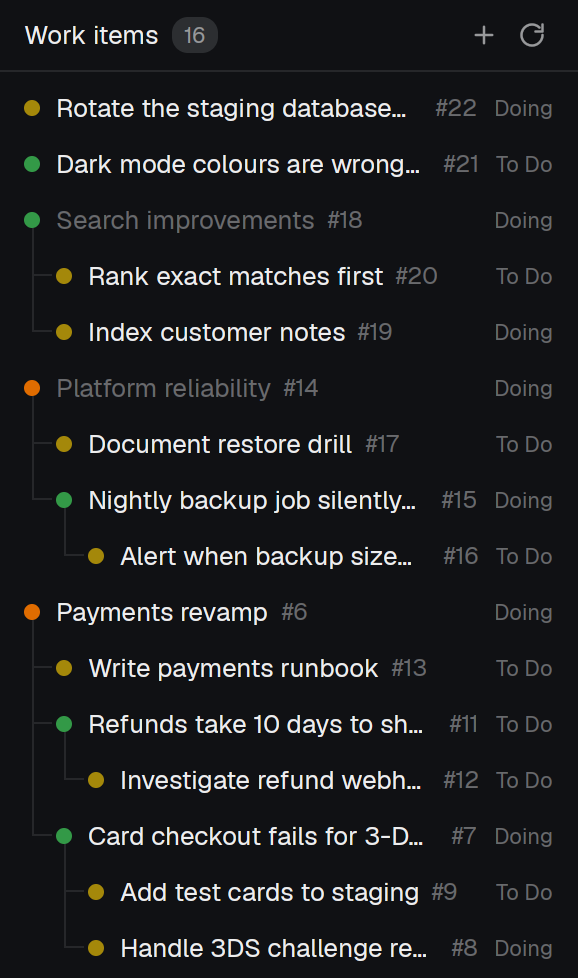

# ADO Work Items

A narrow panel on the left of the window that lists the Azure DevOps work items
assigned to you and still open: one row each, with a dot in the type's ADO color,
its `#id`, its title and its state. "Open" follows each state's ADO category, so it
works for Basic, Agile, Scrum, CMMI and custom processes alike. A Task whose parent
is also yours sits indented under it. One whose parent isn't yours sits under a dim
line naming that parent. Most recent activity is first. Clicking a row opens the item in your browser, and **+** opens the project's
Work Items page in the browser to create one there. It refreshes itself every two
minutes, or when you click ↻.

## What you see

The panel is 300px wide, docked on the left (`mod.json` `"place": "left"`), filling the
full height, on the theme's `chrome` background.

- **Header**, 36px tall, 12px side padding, `border` line under it:
  - left: "Work items" (13px, semibold, `foreground`), then the item count in a pill
    (11px, `muted` text on `raised`, 6px side padding, radius 8). The pill appears only
    after the first successful load.
  - right, 2px apart: a **+** button (`plus.svg`), then a refresh button
    (`refresh.svg`). Each is a 14px `muted` icon in a 4px-padded button with radius 4.
    While a load is running, the refresh icon becomes a ring spinner (`spinner.svg`)
    turning once every 900ms.
- **List**: scrolls vertically with a scrollbar, 4px padding, no gap between rows (so
  the tree guides join). Each row is 28px tall, radius 6, with 8px side padding and
  8px gaps:
  - an 8px round dot in the type's own Azure DevOps color, the same one the ADO web UI
    uses (e.g. Basic: Issue `#339947`, Task `#A4880A`, Epic `#E06C00`). A type with no
    known color gets `muted`. These are fixed colors, not theme colors;
  - the title: 13px, `foreground`, truncated with "…" when it doesn't fit. While it is
    cut off, hovering it shows the full title as a tooltip; a title that fits has none;
  - `#<id>` right after the title text, 6px from it: 12px, `dim`. It never truncates
    (a cut-off id is useless), so with a long title it sits right after the "…". The
    title gives up the room, even for ADO's longest ids (10 digits, `#2147483647`);
  - the state ("To Do", "Doing", "Active", …): 11px, `dim`.
  - **Nesting, drawn as a tree:** an item whose parent is also in the list sits under
    it, with one 16px guide column per level in front of its dot. The guides are 1px
    `border`-colored lines, 4px into each column, so each sits right under the dot
    one level up. A parent with children has a stem from its dot down to the bottom
    of its row. In a child's last column, the line comes down from the top and turns
    right (a 9px horizontal at mid-row) into the child's dot: ├ when more siblings
    follow (the line carries on to the row's bottom), └ for the last child. Columns
    for higher levels carry a straight full-height line while that ancestor still has
    siblings to come, and are empty otherwise. The title and `#id` shift right with the
    dot; the state stays right-aligned.
  - **Parent line:** items whose parent isn't in the list get a line above them for
    that parent, laid out like a row at depth 0 with a stem, with its title in `dim`
    instead of `foreground`. Its dot keeps the type color and it shows the parent's current
    state. The items sit under it at depth 1. Items sharing such a parent share one
    line.
- **Messages** take the list's place, 12px text with 12px padding:
  - "Loading work items…" (`muted`) before the first load finishes;
  - "Nothing assigned to you." (`muted`) when the query returns no items;
  - an error in `blocked` (red), e.g. "The az CLI isn't installed. Install it
    (`sudo dnf install azure-cli`) and run `az login`.", "Not signed in. Run
    `az login`.", "Missing the azure-devops extension. …", or "No default
    organization/project. Run `az devops configure --defaults …`". Anything else shows
    the last line of az's stderr.
- **Title bar button (in t3-chrome, not this mod)**: in the Herdr T3 layout's brand bar,
  before "Show inbox", a 28px ghost button (t3-chrome's `button`, size `sm`) with the
  Azure DevOps logo (`mods/ado-work-items/ado.svg`, one-color, `currentColor`). It finds
  the panel's own block in `layout()` (the block whose `content.mod` is
  `ado-work-items`; its id is generated) and runs `layout.toggle` on it; the panel keeps
  its width while hidden; it is pressed (`on`) while the panel
  shows, and its tooltip is "Hide work items" or "Show work items". It is drawn only
  when the layout has the panel. It lives in `~/.config/herdr-app/mods/t3-chrome/main.js`
  (`adoBlock`, and the `ado-items` button), so reinstalling Herdr T3 drops it.
- **Minimum width**: the panel's block in the layout has `"min": 220`, so dragging its
  edge stops at 220px. There is no narrow mode.

## How it behaves

- On start it loads once, then reloads every 120s. Clicking the refresh button reloads
  at once. A click while a load is running does nothing.
- The query is the work items assigned to the signed-in az user (`@Me`) whose state is
  open **for its type**. Every ADO state has
  a category: Proposed, InProgress, Resolved, Completed or Removed. States in Completed
  or Removed count as finished and are hidden, whatever they're called (Done, Closed,
  Inactive, a custom "Shipped"…). Resolved stays visible: Agile's "Resolved" usually
  means it's waiting on you to verify.
- Types that ADO files under `Microsoft.HiddenCategory` never show: Test Case/Plan/Suite,
  Shared Steps/Parameter, Code Review Request/Response, Feedback Request/Response.
  Everything else does, including Story, PBI, Bug, Feature, Epic, Task, Issue and
  custom types.
- Type info (names, colors, state categories) loads with the first refresh, then again
  every 30 minutes and on every ↻ click. If it can't load, the list still works:
  finished means a state named Closed, Removed or Done, and every dot is `muted`.
- **Order:** top-level groups, then the children within each parent, go by most recent
  activity first. A group's activity is the latest change anywhere in it, so working on
  a Task brings its Epic, and the rest of that Epic's tree, to the top.
- The count pill counts your items only, not parent lines.
- Clicking a parent line opens that parent, like any row.
- Hovering a row, a parent line, or the + or refresh button gives it the `hover`
  background.
- **+** opens `<organization>/<project, URL-encoded>/_workitems`, the project's Work
  Items page, in the browser. You create the
  item there with ADO's own "New Work Item" button, so the type, the required fields
  and what you're allowed to create are ADO's and your org's business. The mod writes
  nothing to ADO. A new item shows up in the panel once it's assigned to you and the
  next refresh runs. Before the org and project are known, + does nothing.
- Clicking a row opens `<organization>/<project, URL-encoded>/_workitems/edit/<id>`
  in the system browser, e.g.
  `https://dev.azure.com/myorg/My%20Project/_workitems/edit/4`.
- It shows no agent statuses (it doesn't use agents) and binds no keys. There's no
  `keys.json`.

## Built from

- `mods/ado-work-items/mod.json`: `{ "place": "left", "size": 300 }`. No layout file:
  Herdr docks one copy into the shown layout the first time it sees the folder.
- `mods/ado-work-items/main.js`: one `View` class.
  - Imports `View, div, svg` from `gpui-kit`, `v_flex, h_flex` from `gpui-base`, and
    `exec, checking, theme` from `herdr`.
  - `init(props, cx)`: optional `props.org` / `props.project` override the az defaults.
    It returns early when `checking()` is true. Otherwise it calls `refresh(cx)`, then
    `cx.timer.every(120000, …)`.
  - `loadTypes(force)`: unless loaded within 30 minutes (and not forced by ↻), runs
    `exec("az", ["devops","invoke","--area","wit","--resource","workitemtypes",
    "--route-parameters",`project=${project}`,"--org",org,"--api-version","7.1",
    "--detect","false","-o","json"])`. The result's `value[]` holds each type's
    `name`, `color` (6 hex digits, no `#`), `isDisabled`, and `states[]` with `name`
    and `category`. It keeps `this.types`, and maps type names to `#`+color. On failure
    it keeps whatever it had before.
  - `base()`: `<org without trailing />/<encodeURIComponent(project)>/_workitems`.
    `plus(cx)` calls `cx.open_url(base())`.
  - `buildWiql(types)`: for each enabled type, the names of its states whose category
    isn't Completed or Removed. These become
    `([System.WorkItemType] = 'Task' AND [System.State] IN ('To Do', 'Doing')) OR …`,
    with `'` doubled inside names. Types with no open states are skipped. With no type
    info, it uses `[System.State] NOT IN ('Closed', 'Removed', 'Done')` instead.
  - `refresh(cx, force)`: sets `loading` and runs everything in `cx.spawn`. If the org or project
    is missing, it runs `exec("az", ["devops","configure","--list"])` and parses the
    `organization = …` / `project = …` lines of the ini output. Then it runs `loadTypes`, then
    `exec("az", ["boards","query","--org",org,"--project",project,"--wiql",buildWiql(types),
    "--detect","false","-o","json"], { timeout: 60000 })` and maps each result
    `{id, fields}` to `{id, title: fields["System.Title"], state:
    fields["System.State"], type: fields["System.WorkItemType"], changed:
    fields["System.ChangedDate"], parent: fields["System.Parent"]}`. Then it runs
    `loadContext`.
  - `loadContext(force)`: the parent ids that aren't in the list and aren't cached
    yet. If there are any, one more `az boards query` with `SELECT [System.Id],
    [System.Title], [System.State], [System.WorkItemType] FROM WorkItems WHERE
    [System.Id] IN (…)`. It caches `{id, title, state, type}` per id in
    `this.context`. ↻ (force) clears the cache first. A failure just leaves those items
    without a parent line.
  - `arrange(items, context)` (exported, pure): returns the rows to draw as
    `{kind: "item" | "context", w, depth, rails, last, stem}`. `rails[i]` says whether
    the guide of level i+1 continues past the row (`!last` of that ancestor, collected
    from depth 1 down). `last` marks a parent's last child, and `stem` a row with
    children (context rows always have one). Children are mapped by `parent` when the
    parent is in the list. Each item's activity is the latest `Date.parse(changed)` in
    its subtree. Roots with a known outside parent are grouped under one context row
    per parent. Everything is sorted by activity, newest first, and walked depth-first.
    A visited set guards against parent loops, and any item left unplaced is added
    flat.
  - The WIQL: `SELECT [System.Id], [System.Title], [System.State],
    [System.WorkItemType], [System.ChangedDate], [System.Parent] FROM WorkItems WHERE
    [System.AssignedTo] = @Me AND [System.WorkItemType] NOT IN GROUP
    'Microsoft.HiddenCategory' AND (<per-type open states>) ORDER BY
    [System.ChangedDate] DESC`.
  - `row({kind, w, depth, rails, last, stem})`: `h(28).px(8)`. First an `h_flex` of
    `guides(depth, rails, last)` (depth > 0) and the node: a `v_flex` 8px wide and 28
    tall, holding a 10px spacer, the 8px dot, and a 10px bottom part. When `stem` is
    set, the bottom part holds `div().ml(4).w(1).h(10)` in `border`. Then an `h_flex().flex_1().min_w(0).gap(6)` holding the
    title (`min_w(0).truncate()`, no flex-grow) and the `#id` (`flex_none`), so the id
    hugs the end of the title. That `h_flex` is also `relative().overflow_hidden()` and
    holds a third child, an invisible `absolute().top(0).left(0).whitespace_nowrap()`
    copy of the title at 13px: its width is the title's full width. Both the title
    (id `ado-title-<kind>-<id>`) and the copy (`ado-measure-<kind>-<id>`) report their
    width with `on_size_change`; when the title is narrower than the copy it is cut off
    and gets `.tooltip(title)`. The view redraws only when that changes. Then the state (`flex_none`). Context rows draw the title in `dim`.
  - `guides`: for each level but the last, a `w(16).h(28)` column holding
    `div().ml(4).w(1).h(28)` when `rails[i]`. Then the last column, a `v_flex`
    `w(16).h(28)`: a top half `h_flex().h(14).items_end()` with the `ml(4) w(1) h(14)`
    line and a `w(9).h(1)` stub, plus a bottom `ml(4) w(1) h(14)` line unless `last`. The element id is `ado-<kind>-<id>`, so a parent line and a
    row for the same id never clash.
  - Row click: `cx.open_url(`${base}/edit/${id}`)`. The + and refresh buttons call
    `cx.stop_propagation()` first. Refresh calls `refresh(cx, true)`, which also
    reloads the type info.
  - Width comes from `.id("root").on_size_change(...)` on the root `v_flex`. It only
    calls `cx.notify()` when the rounded width changes.
  - Colors come only from `theme()`: `chrome`, `border`, `foreground`, `muted`, `dim`,
    `raised`, `hover`, `blocked`. The type dots use ADO's hex colors, falling back to
    `muted`.
- Art, all 24×24 stroked with `currentColor` so `svg()` tints them:
  - `plus.svg`: paths `M5 12h14` and `M12 5v14`, stroke 2, round caps and joins.
  - `refresh.svg`: a circular arrow. The paths are `M21 12a9 9 0 1 1-2.64-6.36` and
    `M21 3v6h-6`, stroke 2, round caps and joins.
  - `spinner.svg`: a ring at 0.24 opacity plus a quarter arc, `r=9.4`, stroke 3.2.
    It's a copy of Herdr's own spinner, kept inside the mod so it doesn't depend on a
    shipped mod's files.
- Programs it runs: `az` (Azure CLI) with the `azure-devops` extension.
- Network: through `az` only. There's no `fetch`, and the mod never sees a token.

## Watch out

- **Setup the build assumes:** the `az` CLI is installed (on Fedora,
  `sudo dnf install azure-cli`), plus `az extension add --name azure-devops`,
  `az login`, and
  `az devops configure --defaults organization=https://dev.azure.com/<org> project="<Project Name>"`.
  Give the project's plain name with real spaces, not the `%20` form from the browser
  URL: the mod URL-encodes the name itself, so `%20` would come out as `%2520`.
- **No results means no output:** with zero matches, `az boards query` exits 0 and
  prints nothing, not even `[]`. Parse `stdout || "[]"`, or the empty state turns into
  a JSON error.
- Pass `--detect false`. Otherwise az looks for an Azure DevOps git remote in the
  current folder and writes a WARNING to stderr on every call.
- `--wiql` returns only the fields named in `SELECT`. Add a field there before reading
  it.
- **Never hard-code state names.** They differ per process (Basic: To Do / Doing /
  Done; Agile: New / Active / Resolved / Closed; Scrum: New / Approved / Committed /
  Done) and per custom process. Filter by category from the `workitemtypes` call.
  Build the filter per type (type AND state IN …): one state name can be finished in
  one type and open in another (e.g. "Closed" vs "Active" on Test Plan).
- The per-type list is a snapshot. A state added to a type in ADO is missing until
  the next type reload (30 minutes, or ↻), so items in it don't show until then.
- WIQL accepts `NOT IN GROUP 'Microsoft.HiddenCategory'` for types, but there is no
  way to filter states by category in WIQL. Hence the per-type state list.
- ADO colors come without `#` and are fixed: they don't follow a light or dark Herdr
  theme. Some (e.g. `#004B50`) are dark on a dark sidebar. Those types are mostly
  hidden-category ones, which never show.
- A manual refresh costs two az calls (types + query), plus one when some parents
  are outside the list. A timed one costs one call, plus one only when there are
  parents not yet cached.
- `[System.Parent]` is a plain WIQL field: select it, no link query
  (`FROM WorkItemLinks`) needed. It's null for items without a parent. `az` prints it
  as `None` in `-o tsv`, and as `null` in JSON.
- Parent lines go one level up only. With Epic (yours) > Feature (someone else's) >
  Task (yours), the Task sits under a "Feature" parent line, and the Epic is a
  separate top-level row, not joined to it.
- A parent's title on its line can be up to one refresh old within a session: it's
  cached until ↻.
- Don't offer a list of types to create. The `workitemtypes` call returns every type
  the process defines, not what this person may create. ADO has no per-type "can
  create" permission to ask about: orgs that keep ICs off Epics or Features do it
  with area permissions or rules that only apply on save. Sending + to ADO's own page
  leaves that to ADO.
- `herdr-app check` runs `init()` for real, so keep the `checking()` guard before any
  `exec`, or every check calls az.
- Each az process takes a few seconds (az starts slowly).
  Don't poll faster than every couple of minutes. The panel keeps polling while
  hidden.
- `cx.open_url` accepts only absolute http(s) URLs, so the organization default must
  be a full `https://dev.azure.com/<org>` URL.
- Ids never truncate, so the title pays for them. At about 330px wide, a depth-3 row
  with a 10-digit id still shows about 5 characters of title. In a narrower panel
  (between the 220px minimum and about 240px), a deep row with a 7+ digit id can leave
  no room for the title. Nothing handles that yet.
- There's no limit on the number of items: an account with hundreds of open items
  renders them all in a plain scroll list. It's not virtualized.
- When `exec` can't start `az`, the mod treats that as "not installed". It recognizes
  this from the error text (ENOENT / not found).

## Done when

- `herdr-app check ~/.config/herdr-app/mods/ado-work-items` prints "check passed", and
  `herdr-app status` shows `"errors": []`.
- With az not installed, the panel shows the red "The az CLI isn't installed…" message.
- With az set up and nothing assigned, it shows "Nothing assigned to you." (the count
  pill shows 0).
- With items assigned, its rows match, in order, the ids, titles and states printed by
  `az boards query --detect false --wiql "<the WIQL above>" -o table`, and each dot has
  the color `az devops invoke --area wit --resource workitemtypes` reports for its type.
- Moving an item to a Completed-category state (e.g. Done) removes it on the next
  refresh.
- A Test Case assigned to you never shows. With the filter that excludes
  Closed/Removed/Done names only, it would.
- Clicking a row opens that item's `_workitems/edit/<id>` page in the browser.
- With Task #B's parent set to Epic #A and both assigned to you and open, #A shows at
  the top level and #B right under it, with a line from #A's dot turning (└) into
  #B's dot. Changing #B moves the pair
  above items changed less recently.
- In a three-level tree (Epic > Issue > two Tasks, plus a second Task under the Epic),
  the Epic's line runs past the Issue's children down to the second Task (├ then └),
  with no breaks between rows.
- With a parent that's not assigned to you, its #id and title show as a dim line with
  your item hanging from it. `arrange` handles nesting, deep chains, shared outside
  parents, a parent loop and flat order.
- Clicking + opens `<organization>/<project>/_workitems` in the browser, where ADO's
  "New Work Item" button creates an item.
- Clicking ↻ shows the spinner, then the list again. A new item assigned to you
  appears without restarting Herdr.
- Dragging the panel's edge to the left stops at 220px; the list still shows titles.
